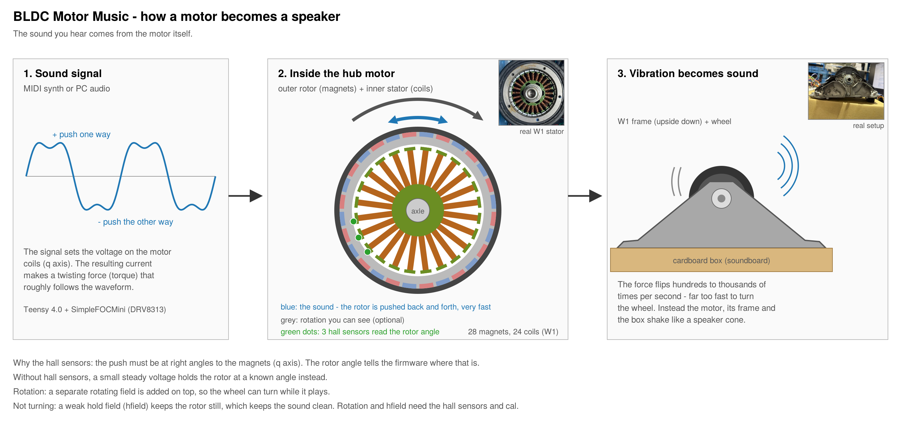
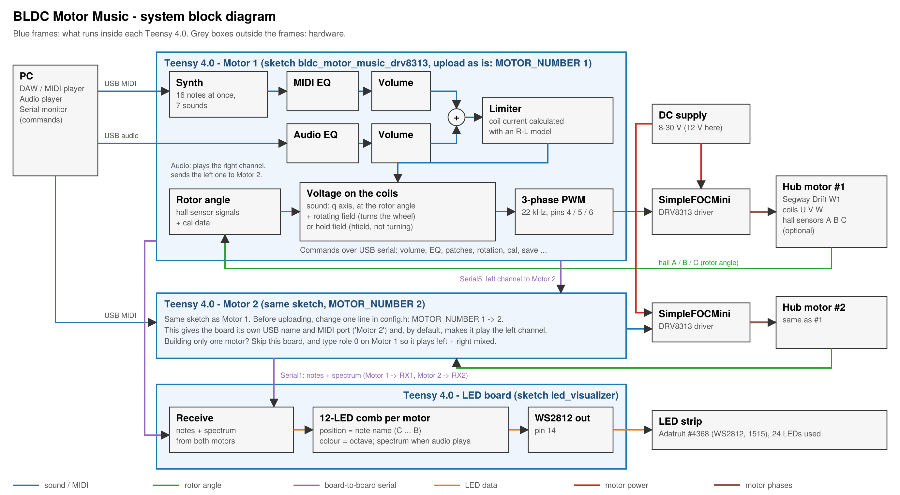
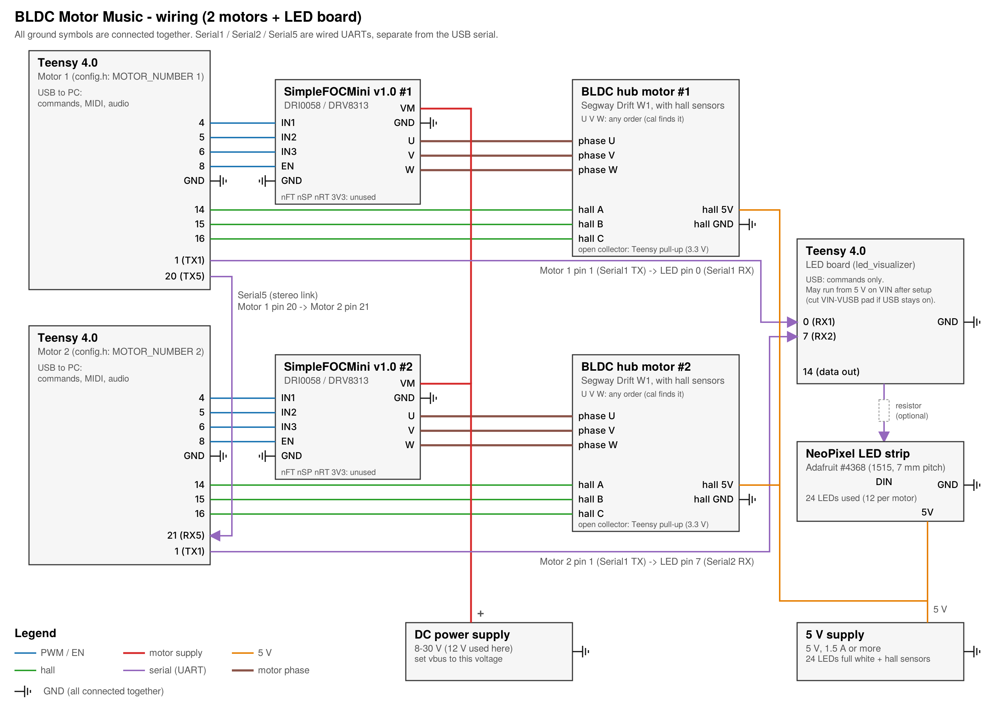

# BLDC Motor Music

**Every brushless motor has a voice. Play MIDI or any sound from your PC through it. Not hi-fi, but in tune.**

This firmware, running on a Teensy 4.0, makes the motor itself the sound source.

Several motors were tried. Small gimbal motors played in tune, but quietly. For more volume,
this build uses two hub motors from a pair of
[Segway Drift W1](https://www.youtube.com/watch?v=2929b8jcFQ4) e-skates. They were made to
carry a rider; picked up as junk on the used market, they now play music.

Videos: [BLDC Motor Music on YouTube](https://www.youtube.com/playlist?list=PLEj_MQua_vIk)

## What it does

- **Plays MIDI** from your DAW or MIDI player, with a synth built into the firmware: 16 notes
  at once per motor, 7 built-in sounds and drums, pitch bend, vibrato (mod wheel), sustain pedal
- **Plays any sound from your PC** — it works as a USB audio device, so whatever the PC plays
  comes out of the motor
- **Stereo with two motors** — Motor 1 plays the right channel, Motor 2 the left
- **Turns while it plays** — the wheel can rotate during the music
- **LEDs (optional)** — note names for MIDI, a spectrum for PC audio

## How it works

### The motor is the speaker

The firmware drives the coils with the sound waveform. This pushes the rotor one way, then
the other, hundreds to thousands of times per second — far too fast to turn the wheel — so
the motor, its frame and whatever it stands on vibrate and move the air, like a speaker cone.

To push the rotor back and forth, the coils must pull its magnets sideways, not straight in,
so the firmware needs the rotor angle. Hall sensors in the motor report it. Without them, a
small steady voltage holds the rotor at a known angle. The motor still plays, but
rotation is unavailable.



### Why it stays in tune

Every note is calculated inside the Teensy, one sample at a time, driven by a hardware timer
at 24 MHz ÷ 544 (44,117.6 samples per second). Each note's frequency comes
straight from the equal-temperament formula (A4 = 440 Hz, changeable with `a4`). Each note
keeps its phase including the fraction of a sample, so a period is never rounded to whole
samples. Running the same math on a PC shows a calculation error below 0.04 cent across all
88 piano keys.

The pitch does not change when the Teensy is busy. USB, the LEDs and typed commands are
handled in the time between samples, and the timer keeps its rate. At worst a MIDI note can
start a little late. PC audio is resampled to follow the PC's clock, so it also keeps its
original pitch.

### Why it is not hi-fi

A motor is not built to be a speaker. It plays the middle range best; low and high notes come
out weaker, a bit like a telephone.

The firmware's EQ can lift the weak ranges, but lifting takes current: +6 dB needs twice the
current. This build is limited by the motor driver's 2.5 A. Volume and EQ share that limit, so
the flatter you make the sound, the quieter it gets.

A larger driver and motor raise the limit. The lowest and highest notes depend more on the
motor itself and what it stands on, so they gain less.

### What runs where

Everything — the synth, USB audio and motor control — runs inside each Teensy 4.0.
The SimpleFOCMini (DRV8313) is the power stage: it switches the three motor phases from the
Teensy's PWM signals.



## Getting started

### 1. Parts

| Part | Used here | Notes |
|---|---|---|
| Microcontroller | [Teensy 4.0](https://www.pjrc.com/store/teensy40.html), one per motor | |
| Motor driver | [DFRobot SimpleFOCMini](https://www.dfrobot.com/product-3013.html) (DRV8313), one per motor | 8–30 V, 2.5 A peak |
| BLDC motor | Segway Drift W1 hub motor × 2 | Other BLDC motors: see [Using your own motor](#using-your-own-motor). Hall sensors are optional: without them the motor still plays, but rotation is unavailable. |
| Motor power | DC constant-voltage power supply | Used at 12 V. In a two-motor test at maximum volume with boosted bass and treble, the supply's display showed about 0.16 A during normal playing and briefly about 0.25 A on loud EDM kick hits. The 2.5 A above is the driver's limit for the motor-coil current, not the current drawn from the supply. |
| 5 V supply | USB adapter | For the hall sensors and the LED strip; 1.5 A or more with LEDs |
| LEDs (optional) | Teensy 4.0 + [Adafruit #4368](https://adafruit.com/product/4368) strip | Uses 24 of the 75 LEDs |

One motor is enough to start. A second motor adds stereo.

### 2. Wiring



Hall sensor outputs must be open-collector: Teensy pins are not 5 V tolerant.

### 3. Upload

1. Install Arduino IDE 2 and [Teensyduino](https://www.pjrc.com/teensy/td_download.html).
   New to Teensy? Start with PJRC's [setup tutorial](https://www.pjrc.com/teensy/tutorial.html).
   Tested with Arduino IDE 2.3.6 and Teensyduino 1.62.0.
2. Open `bldc_motor_music_drv8313/bldc_motor_music_drv8313.ino`.
3. In `config.h`, set `MOTOR_NUMBER` to 1 for the first motor, 2 for the second.
4. Select **Tools → Board → Teensy 4.0** and **Tools → USB Type → Serial + MIDI + Audio**.
   With another USB Type the build stops with
   `Arduino IDE: Tools > USB Type > Serial + MIDI + Audio`.
5. Upload.

Upload `led_visualizer/led_visualizer.ino` to the LED board the same way, with USB Type **Serial**.

### 4. First sound

**Heat.** On this setup (W1 + SimpleFOCMini), normal playing has been fine. Playing loud for
a long time can make things hot. The firmware cannot measure the current: `imax` limits the
current as calculated from `R_EFF`, and the real current can differ (see
[Using your own motor](#using-your-own-motor)). If the motor gets hot, lower `imax`.
If the driver gets hot, add a heatsink or a fan.

Open the Serial Monitor (line ending "Newline") and type the lines below. Without hall sensors,
leave out `cal`.

```
vbus 12      your motor supply voltage (8-30)
cal          the wheel turns slowly forward and back; it must be free to turn
tone 440     you should hear A4 from the motor
tone 0
save
```

`cal` finds the phase order and the hall sensor angles, so the motor wires U, V, W can go in
any order. It ends with `cal: OK, saved`. Without hall sensors, the message `cal: not done yet`
at power-up can be ignored.

Settings change at once, but are lost at power-off unless you type `save`. Saved settings
stay after you upload the firmware again. Details: [docs/commands.md](docs/commands.md).

## Play from your PC

| What | How |
|---|---|
| MIDI | In your DAW or MIDI player, choose **Motor 1** / **Motor 2** as the MIDI output |
| Audio | In the Windows sound settings, choose **Digital Audio Interface (Motor 1)** as the output. The first part is shown in your Windows language. |

**With two motors,** the PC lists both Motor 1 and Motor 2. Choose Motor 1: it plays the right
channel and passes the left channel on to Motor 2. Sound sent directly to Motor 2 is not played.

**With one motor:** the firmware is set up for two motors in stereo, so one motor alone plays
only the right channel. Type `role 0` and `save` to play left + right mixed.

MIDI and audio can play at the same time.

### Sounds

The firmware has 7 built-in sounds. The 128 General MIDI programs are grouped onto them by
instrument family — for example, all eight guitars play the guitar sound. Programs not listed
in the table play epiano.

| Sound | What it sounds like | General MIDI programs |
|---|---|---|
| 1 epiano | sine with fading overtones, like an electric piano | 1–4 (Piano), and any program not listed |
| 2 fm-epiano | FM electric piano | 5–6 (Electric Piano) |
| 3 organ | four harmonics, sustained | 17–24 (Organ) |
| 4 guitar | softly clipped sine, fading | 25–32 (Guitar) |
| 5 saw | band-limited sawtooth | 82 (Synth Lead: Sawtooth) |
| 6 square | band-limited square | 81, 83–88 (Synth Lead) |
| 7 triangle | triangle in 16 steps (chiptune-like) | 33–40 (Bass) |
| drums | kick, snare, hi-hats, cymbals, toms | channel 10 |

- Program changes in the MIDI file choose the sound for each channel.
  Channels without a program change play epiano.
- To play everything with one sound, type `pc 0` and `patch <1-7>` (in the commands, a sound
  is called a patch). The choice is not saved; after power-up all channels start as epiano.
- Each motor plays up to 16 notes at once. For busy songs, split the parts between Motor 1 and Motor 2.

To shape the sounds themselves (attack, decay, overtones …), see [docs/commands.md](docs/commands.md).

## Volume and tone

MIDI and PC audio have separate controls: commands starting with `m` are for MIDI, `a` for audio.

| Command | What it does |
|---|---|
| `mvol 0-100`, `avol 0-100` | Volume. −10 dB per 25, 0 = off |
| `mbass <dB>`, `mbfreq <Hz>` | Bass shelf |
| `mtreble <dB>`, `mtfreq <Hz>` | Treble shelf |
| `mmid <1-4> <Hz> <dB> [Q]` | Up to 4 peaking filters |
| `mhpf <Hz>`, `mlpf <Hz>` | High-pass / low-pass, 0 = off |
| `save` | Keep the settings |

EQ ranges: −30 to +30 dB, 20 to 20000 Hz. Chords add up, so loud chords are limited.

Use the EQ to find the sound you like for your motor and how it stands.

## Rotation and LEDs

### Rotation

Rotation is a show gimmick. A rotating field is added on top of the sound, on the same coils,
and the rotor follows it. The field takes part of the driver's current and voltage, so with
rotation on, the sound is limited a little earlier.

When the wheel is not turning, a weak hold field (`hfield`) keeps the rotor still, which keeps
the sound clean. Rotation and the hold field use the hall sensors and `cal`.

| Command | What it does |
|---|---|
| `smode 0-3` | 0 off, 1 constant speed, 2 follows how many notes are played, 3 follows the loudness |
| `orpm <rpm>` | Speed for `smode 1` |
| `hfield <V>` | Hold field when not turning; uses some current, like rotation |

### LEDs (optional)

A separate Teensy drives the LED strip. Each motor board sends it the notes it plays and, for
PC audio, a spectrum. Each motor has its own row of 12 LEDs, one per note name (C to B);
the colour shows the octave.

What is sent to the LEDs is set on the motor boards (`spec`; `spec 0` turns the spectrum off).
How they light — position, brightness, fading — is set on the LED board, in its own Serial
Monitor (`pos1`, `pos2`, `bright`, `fade` …; type `help` there).

## Using your own motor

Edit `config.h` before uploading:

| Setting | How to find it | W1 example |
|---|---|---|
| `POLE_PAIRS` | Number of magnets ÷ 2. It is used only to convert the rotation speed; if it is wrong, the wheel turns at the wrong speed, but the sound is not affected | 28 magnets → 14 |
| `R_EFF` | Phase resistance (phase-to-phase ÷ 2) plus the driver's FET resistance (0.24 Ω for DRV8313). The firmware cannot measure the current. It keeps the voltage low enough that, calculated with `R_EFF`, the current stays under `imax`. If `R_EFF` is higher than the real value, more current than `imax` can flow, so if unsure, use a lower value | 0.2 ÷ 2 + 0.24 = 0.34 |
| `IMAX_LIMIT` | The driver's current limit. Keep 2.5 for the SimpleFOCMini | 2.5 |

Then set `vbus`, run `cal` if the motor has hall sensors, and adjust the volume and tone by ear.

## Under the hood

- **One interrupt, one sample.** A 44.1 kHz timer interrupt does everything for each sample:
  rotor angle → synth voices → USB audio → rotating field → EQ and limiter → PWM.
  If a pass takes longer than 19 µs, the quietest voice is released to keep up.
- **The synth** computes each voice sample by sample: sine with overtones (epiano), FM,
  four-harmonic organ, soft-clipped sine (guitar), PolyBLEP saw and square, stepped triangle.
  Drums are a falling-pitch kick and tom, and noise for snare, hi-hats and cymbals.
- **Rotor angle.** The hall sensors give the angle every 60 electrical degrees; in between it
  is calculated from the speed. The sound is applied on the q axis at that angle.
- **Voltage, not current.** The firmware sets the voltage on the coils; the DRV8313 has no
  current sensing. The limiter keeps the voltage low enough that the current, calculated with
  `R_EFF`, stays under `imax`.
- **PWM.** 22 kHz, exactly two samples per period, so the motor gets a new value every period.
  Dead-time compensation corrects the small voltage error the driver adds.
- **Rotation** is open loop. If the rotor falls far behind the field, the field restarts at the rotor's angle.
- **LEDs.** For MIDI, each motor board forwards every note-on and note-off; the LED for that
  note name lights in the colour of its octave and fades after the note ends. For PC audio,
  the motor board analyses the sound it plays (FFT, about 60 times per second, 100–5000 Hz)
  and adds up the energy for each note name across all octaves, so the LEDs show which notes
  are in the music, in the same layout as MIDI; the colour shows the strongest octave.
  With two motors, Motor 1 analyses the stereo mix and splits it: low notes on one row, high
  notes on the other.
- **Stereo.** Motor 1 sends the left channel to Motor 2 over a serial line. Both follow the PC's audio clock.
- **Another driver?** Driver-specific code is in `drv8313.cpp` and `config.h`. A port replaces these two files.

## Notes

- When nothing plays for 0.3 s, the driver is switched off: the wheel turns freely and no current flows.
- `stat` shows the limiter, voice use and timing; `cpu 1` / `cpu 0` measures the load.

## More

- All commands: [docs/commands.md](docs/commands.md)

## License

MIT License. See [LICENSE](LICENSE).
